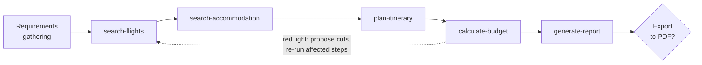

# ✈️ AI Travel Agent

**Smart trip planning with an orchestrated team of AI skills, built for [OpenCode](https://opencode.ai).**

AI Travel Agent turns a handful of requirements (destination, budget, dates, interests, travelers) into a complete, budget-checked travel plan: flights, accommodation, a day-by-day itinerary, a budget traffic light, and a final standalone report, optionally exported to PDF.

It was developed as the *AI Full — Project Work*: a multi-skill agent where one orchestrator coordinates five specialized skills and three optional remote MCP servers.

---

## Table of contents

- [What it does](#what-it-does)
- [How it works](#how-it-works)
- [The skills](#the-skills)
- [MCP servers](#mcp-servers)
- [Project structure](#project-structure)
- [Installation](#installation)
- [Usage](#usage)
- [Test scenarios](#test-scenarios)
- [Design principles](#design-principles)
- [Limitations](#limitations)

---

## What it does

Given a trip request, the agent:

1. **Collects and confirms** all requirements before doing anything.
2. **Finds flights** (at least 3 options, with a budget check).
3. **Finds accommodation** that fits the remaining budget and the interests.
4. **Plans a day-by-day itinerary** with themes, activities, meals, and costs.
5. **Calculates the budget** and shows a 🟢 / 🟡 / 🔴 traffic light with cut suggestions.
6. **Generates a 6-section report** and offers to export it as a PDF.

If a data source is unavailable, the agent keeps going using LLM knowledge and clearly labels those figures as estimates.

---

## How it works

The `travel-agent` orchestrator runs the five skills in a **fixed order**. Each skill's output becomes the next skill's input through a shared *trip context*.



### Trip context

The orchestrator carries a single structure through the whole flow, so every skill sees what came before (for example, the flight cost reaches `calculate-budget`, and the itinerary reaches `generate-report`):

```yaml
requirements:   { departure, destination, dates, duration_days, total_budget, interests, travelers }
flights:        { chosen_option, total_cost }
accommodation:  { chosen_option, total_cost }
itinerary:      { days: [ { day, theme, activities, meals, cost } ], total_cost }
budget:         { categories, traffic_light, suggestions }
```

### Required inputs

| Requirement | Example |
|---|---|
| Destination (and departure city) | Lisbon, from Turin |
| Total budget (€) | €1200 |
| Dates / duration | 5 days, March 12–17 |
| Interests | food, beaches, history |
| Travelers | 2 people |

The agent will not start until it has all five, and it asks for confirmation of the summary first.

---

## The skills

Every skill is defined with the same **canvas template**: Name · Goal · Input · Output · System Prompt (3–5 rules) · Limits · MCP.

| # | Skill | What it does | Main MCP | Pay attention to… |
|---|---|---|---|---|
| 1 | [`search-flights`](skill/search-flights.md) | Compares round-trip flight options in a table (airline, price, duration, stops) | `parallel-search` | At least 3 options, budget check |
| 2 | [`search-accommodation`](skill/search-accommodation.md) | Proposes hotels/apartments with name, price per night, rating, area, and stay total | `gondola` | Area + rating + total |
| 3 | [`plan-itinerary`](skill/plan-itinerary.md) | Builds a day-by-day plan with theme, activities, meals, and costs | `viator` | Daily budget, meals included |
| 4 | [`calculate-budget`](skill/calculate-budget.md) | Sums all costs by category, adds ~10% contingency, assigns a traffic light | none | Traffic light + cut suggestions |
| 5 | [`generate-report`](skill/generate-report.md) | Produces the final standalone report | `parallel-search` | Standalone report, 6 sections |
| + | [`export-pdf`](skill/export-pdf.md) | Exports the whole result to a polished A4 PDF | none | Fidelity to the report, design, file size |

### 1. `search-flights`
- **Input:** departure city, destination, dates, travelers, total budget.
- **Output:** table of 3+ options (cheapest, fastest, best compromise) with price per person and total, duration, and stops; recommended option; flights `total_cost`; share of the budget used.
- **Key rule:** if flights exceed ~40% of the total budget, flag it and suggest alternatives (flexible dates, layovers, nearby airports).

### 2. `search-accommodation`
- **Input:** destination, nights, travelers, remaining budget after flights, interests.
- **Output:** table of 3+ options across price ranges with name, price per night, rating, area, and stay total; recommended option; accommodation `total_cost`.
- **Key rule:** explain why the area fits the interests and transport links; never invent ratings (unverified ones are marked as estimates).

### 3. `plan-itinerary`
- **Input:** destination, duration, travelers, interests, accommodation area, remaining budget.
- **Output:** a table with one row per day (theme, morning, afternoon, evening, meals, estimated cost), plus total cost and average daily budget.
- **Key rule:** each day has a theme, respects the daily budget, groups activities by proximity, and caps the plan at 3–4 main activities per day.

### 4. `calculate-budget`
- **Input:** costs from the previous skills and the user's total budget.
- **Output:** cost table by category (flights, accommodation, activities, meals, local transport/contingencies) with percentages, a traffic light, the remaining margin, and cut suggestions with estimated savings.
- **Traffic light:**

| Light | Meaning |
|---|---|
| 🟢 Green | Total ≤ 90% of the budget |
| 🟡 Yellow | Total between 90% and 100% |
| 🔴 Red | Total over 100% |

### 5. `generate-report`
- **Input:** the full trip context.
- **Output:** a standalone report in 6 sections:
  1. Trip summary
  2. Flights
  3. Accommodation
  4. Itinerary
  5. Budget
  6. Practical tips (documents, weather, local transport, safety, what to book in advance)
- **Key rule:** uses the exact data from the other skills without recalculating it, and distinguishes MCP-verified data from LLM estimates.

### Bonus: `export-pdf`
- **Input:** the final report and the full trip context.
- **Output:** `travel-plan_<destination>_<date>.pdf`, a professionally designed A4 document: cover page, at-a-glance KPI cards, table of contents, styled tables, one card per itinerary day, budget bar chart with traffic-light badge, running header/footer, and a closing disclaimer.
- **Key rules:** exports everything without altering data, uses a consistent palette and typography, never prints emoji, targets a file size under 1 MB, and verifies the layout before delivering.
- **Generation:** installed PDF skill → Python `reportlab` → HTML/CSS to PDF → Pandoc → print-ready HTML fallback. It never blocks the flow.

---

## MCP servers

The project uses three **remote MCP servers**, all optional (configured in [`opencode.jsonc`](opencode.jsonc)):

| Server | URL | Used by |
|---|---|---|
| `parallel-search` | `https://search.parallel.ai/mcp` | flights, report |
| `viator` | `https://exp-app-mcp.prod.ep.viator.com/mcp` | itinerary (tours and activities) |
| `gondola` | `https://mcp.gondola.ai/mcp` | accommodation (hotel search) |

> **Golden rule: MCP is an optimization, not a requirement.** The skills work with LLM knowledge alone.

### Troubleshooting

| Problem | Solution |
|---|---|
| Server not listed in `opencode mcp list` | Check `enabled: true` and restart OpenCode |
| Connection error / 403 / timeout | Move on to the next server; the skill falls back to LLM knowledge |
| Only 1 server out of 3 works | Normal. One is enough |
| No server works | The skills still work without MCP. Carry on |

---

## Project structure

```
.
├── README.md
├── opencode.jsonc              # 3 remote MCP servers
├── travel-agent.md             # Orchestrator (master prompt)
└── skill/
    ├── search-flights.md
    ├── search-accommodation.md
    ├── plan-itinerary.md
    ├── calculate-budget.md
    ├── generate-report.md
    └── export-pdf.md           # Bonus: professional PDF export
```

---

## Installation

**Prerequisites:** [OpenCode](https://opencode.ai) installed and configured with a model.

1. **Clone the repository**
   ```bash
   git clone <your-repo-url>
   cd <your-repo-folder>
   ```
2. **Add the MCP servers.** Merge the `mcp` section of `opencode.jsonc` into your OpenCode configuration.
3. **Verify the servers** (at least 2 out of 3 should be active):
   ```bash
   opencode mcp list
   ```
4. **Install the agent and skills.** Copy `travel-agent.md` into your OpenCode agents folder (e.g. `.opencode/agent/`) and the files in `skill/` into your project's skill folder.
5. **(Optional) PDF export.** `export-pdf` generates the PDF using a PDF-capable tool in your environment (for example Python with `reportlab`, or `weasyprint`). If none is available, it falls back to a print-ready HTML file.

> Folder locations and config syntax can differ between OpenCode versions; check the OpenCode documentation for your version.

---

## Usage

Start OpenCode in the project and ask for a trip in natural language:

```
Plan a 5-day trip to Lisbon from Turin, budget €1200, I love food, beaches and history. I'm traveling alone.
```

The agent will:

1. Confirm the requirements.
2. Show each phase's results as it goes (*Phase 1/5 — Flights*, *Phase 2/5 — Accommodation*, …).
3. Flag a 🔴 budget and propose cuts before re-running the affected steps.
4. Deliver the final report and ask: **"Would you like to export the report as a PDF?"**

### Quick MCP checks

- `Search hotels in Barcelona for 3 nights` → `gondola`
- `What activities in Barcelona?` → `viator`

---

## Test scenarios

| Scenario | Budget | Trip | Interests |
|---|---|---|---|
| 🟢 Low budget, Europe | €1200 | Lisbon, 5 days | Food, beaches, history |
| 🔵 Medium budget, Asia | €3500 | Tokyo, 10 days | Technology, culture, food |
| 🟠 High budget, America | €5000 | New York, 7 days, 2 people | Art, musicals, shopping |

### Orchestrator checklist

- [ ] Does it collect all requirements before starting?
- [ ] Are the 5 skills called in the correct order?
- [ ] Does context pass between skills (flight cost → budget, itinerary → report)?
- [ ] Does the flow continue if an MCP doesn't respond?
- [ ] Is the user asked about the PDF export at the end, and does `export-pdf` produce the file?

---

## Design principles

1. **Fixed order, shared context:** predictable flow, every step builds on the previous one.
2. **Never block:** MCP failures degrade gracefully to LLM knowledge.
3. **Transparency:** verified data and estimates are always distinguished.
4. **Budget-aware at every step:** each skill respects the budget left by the previous ones.
5. **Human in the loop:** requirements are confirmed up front, and red budgets trigger a user decision.

---

## Limitations

- **No bookings:** the agent only proposes plans and estimates; it never books or guarantees availability.
- **Indicative prices:** flights and hotels change quickly; figures without MCP verification are estimates.
- **Opening hours and tickets** are not guaranteed.
- Contingency (~10%) and local transport figures are approximations.

---

## Credits

Built as the **AI Full — Project Work** (*Smart Trip Planning*), using OpenCode skills and the Parallel Search, Viator, and Gondola MCP servers.
